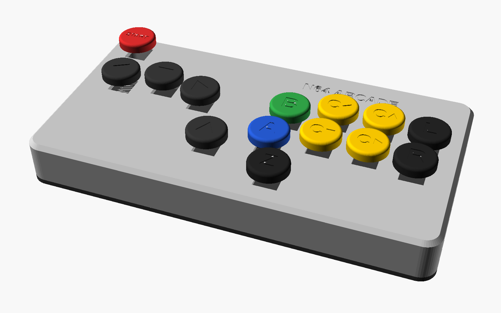
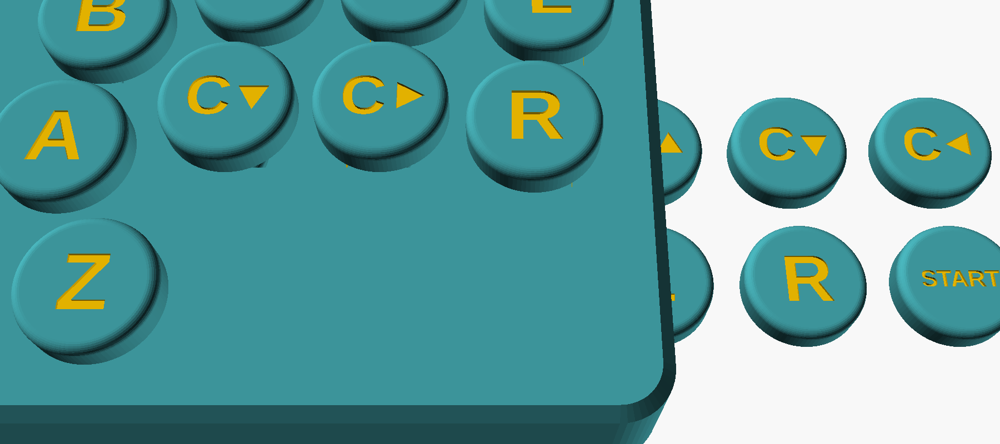

# N64 Arcade — controle hitbox para Nintendo 64 (V1 concluída)

Controle estilo fliperama (hitbox) para Nintendo 64: 14 switches mecânicos MX,
teclas redondas impressas com legenda, caixa impressa sem parafusos e um
Raspberry Pi Pico (RP2040) que conversa com o console pelo protocolo Joybus,
como um controle original. **Testado e aprovado no N64 em 19/11/2026.**

> Projeto da **Indião Retro Games**. Não é afiliado à Nintendo.

## Comece por aqui
| Quero… | Abra |
|---|---|
| Entender o projeto inteiro | `documentacao/Dossie_Tecnico_N64_Arcade_V1_Final.docx` |
| Continuar o projeto com o Claude | `CONTEXTO_DO_PROJETO.md` (peça para ele ler inteiro) |
| Testar os botões ao vivo | `firmware/painel_controle.html` (Chrome ou Edge) |
| Gravar o firmware | `firmware/README.md` |
| Imprimir ou editar a caixa | `caixa/README.md` |
| Soldar a fiação | `caixa/esquema_fiacao.html` |
| Imprimir os adesivos | `caixa/adesivos/adesivos_N64_Arcade_A4.pdf` (100%) |
| Testar a saúde de um Pico | `ferramentas/pico_saude/testar.ps1` |

## Ligação essencial
| Fio / sinal | Pico |
|---|---|
| DATA do cabo N64 (branco) | GP18 · pino 24 |
| GND do cabo N64 (preto) | GND · pino 23 |
| +3,3 V do cabo N64 (vermelho) | **isolado — não ligar** |
| Botões | GP2–GP15 até o GND (pinos 3 e 28) |
| Alimentação | USB (carregador de celular) |

## Uso
1. **Ligar:** carregador na tomada → USB no controle → cabo na porta 1 → liga o N64.
2. **Desligar:** desliga o N64 → depois tira o USB.
3. Não usar a porta USB da TV (ela desliga em espera).

## Pastas
| Pasta | Conteúdo |
|---|---|
| `firmware/` | Código C, `.uf2` prontos, build, painel e monitor |
| `caixa/` | CAD OpenSCAD, STL, projetos fatiados (Bambu A1), teclas, fiação, adesivos |
| `ferramentas/` | Diagnóstico de saúde do Pico, registro de telemetria, página de teste simples |
| `diagnostico/` | Script MicroPython original e logs de telemetria do console |
| `documentacao/` | Dossiê técnico final (Word) |
| `SESSAO_*.md` | Relatos das sessões de teste no console |

## Histórico curto
- **18/11:** firmware Joybus, testes de bancada, caixa modelada.
- **19/11 manhã:** primeiro teste no console aprovado (Pico W).
- **19/11 tarde:** Pico clone montado; falha intermitente "insert a controller"
  capturada por telemetria (receptor desalinhado 1 bit) e corrigida no firmware;
  caixa impressa e fechada. **V1 concluída.**

## Próxima versão (ideias)
Software de configuração (remapear botões, perfis, turbo), controle pela USB,
versão sem fio (ESP32/Pico W + BlueRetro) e adaptação para SNES.

## Créditos
- [libjoybus](https://github.com/loopj/libjoybus) (MIT), de loopj — protocolo Joybus no RP2040.
- [Raspberry Pi Pico SDK](https://github.com/raspberrypi/pico-sdk) (BSD-3-Clause).

## Licença
[CC BY-NC 4.0](https://creativecommons.org/licenses/by-nc/4.0/): você pode usar,
modificar e compartilhar, **com crédito** e **sem fins comerciais**. O logo
Indião Retro Games tem todos os direitos reservados. Detalhes em [LICENSE](LICENSE).

"Nintendo 64" e "N64" são marcas da Nintendo, usadas só para descrever a
compatibilidade.
